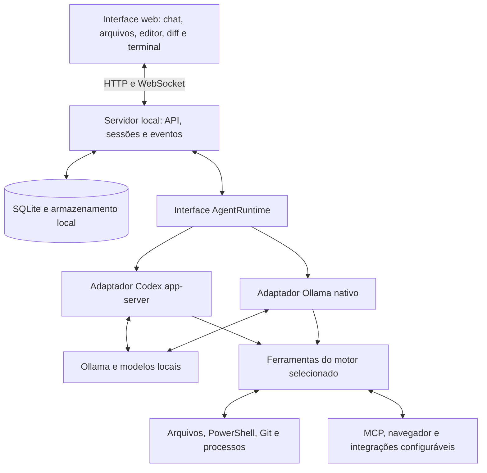

# Codex Web Local — planejamento completo

Versão 2.0 · 27/10/2026 · Planejamento concluído; implementação iniciada, com I01 aceito.

Execução atual: [roadmap](docs/ROADMAP.md), [equipe Terra](docs/EQUIPE_AGENTES.md), [backlog](docs/BACKLOG.md) e [evidências](docs/ACEITE.md). O primeiro chat local está implementado; o produto completo e as fases F0/F1 integrais ainda não estão concluídos.

Esta versão amplia o escopo funcional e visual. Aparência, voz, imagens, documentos, navegador, controle do computador, agentes, automações, acesso remoto e integrações integram a entrega completa. O MVP é apenas um marco intermediário.

Base verificável: **152 requisitos funcionais, 26 telas, 13 requisitos visuais e 9 fases de entrega**. O estado atual de cada requisito e suas evidências estão no backlog; implementação parcial não equivale a aceite integral.

## Documentos da versão completa

| Documento | Conteúdo |
| --- | --- |
| [Escopo funcional](docs/ESCOPO_FUNCIONAL.md) | Requisitos identificados, fases, dependências e critérios de aceite |
| [Especificação visual](docs/ESPECIFICACAO_VISUAL.md) | Telas, componentes, temas, estados, atalhos e responsividade |
| [Arquitetura e entregas](docs/ARQUITETURA_E_ENTREGAS.md) | Serviços, dados, contratos, estimativas e validação |
| [Referências e paridade](docs/REFERENCIAS_E_PARIDADE.md) | Base documental e equivalentes locais |
| [Desktop escuro](docs/design/desktop-escuro.svg) | Referência visual proposta |
| [Desktop claro](docs/design/desktop-claro.svg) | Referência visual proposta |
| [Celular](docs/design/mobile.svg) | Referência visual proposta |

Versões para visualização direta: [desktop escuro PNG](docs/design/desktop-escuro.png), [desktop claro PNG](docs/design/desktop-claro.png) e [celular PNG](docs/design/mobile.png).

As imagens contêm dados ilustrativos. Não são capturas do Codex nem uma aplicação funcionando. Os documentos detalhados complementam e tornam verificável o resumo abaixo.

## 1. Resultado pretendido

Criar um ambiente web pessoal inspirado no Codex: conversar com modelos locais, abrir projetos do computador, pedir mudanças, acompanhar comandos, editar arquivos, revisar diferenças, executar testes e retomar tarefas. Inferência e histórico locais, sem dependência obrigatória de serviços pagos ou conta OpenAI.

O escopo completo inclui projetos, conversas persistentes, editor, terminal, Git, agente autônomo, memória, skills, hooks, plugins, MCP, navegação, controle de aplicativos Windows, pesquisa, tarefas agendadas, agentes especializados, voz, imagens, documentos, publicação e hosts remotos. Também inclui toda a especificação de aparência e interação definida nesta versão. A entrega será incremental, com uma primeira versão utilizável antes dos recursos avançados.

### Autonomia e significado de “sem restrições ou regras”

- Sem camada adicional de moderação de conteúdo na aplicação.
- Prompts de sistema, instruções de projeto, modelos e ferramentas configuráveis pelo proprietário.
- Sem prompt secreto de política de conteúdo; as camadas de instrução e sua precedência serão inspecionáveis.
- Sem cotas comerciais de mensagens ou tokens impostas pelo produto.
- Execução direta no computador disponível, com os privilégios da conta que iniciou o serviço.
- Aprovação de comandos e isolamento opcionais, escolhidos pelo proprietário; perfil de acesso total disponível sem confirmações repetidas.
- Contexto, concorrência, duração e tentativas configuráveis. Restrições físicas de RAM, VRAM, disco e contexto do modelo continuam existindo.
- Nenhuma promessa de remover recusas aprendidas nos pesos, melhorar artificialmente a capacidade de um modelo ou reproduzir integralmente serviços exclusivos do Codex gerenciado.

O botão de interrupção, o histórico das ações e os pontos de restauração são recursos de controle e recuperação. Não devem se transformar em aprovações obrigatórias para cada comando.

## 2. Evidências do ambiente

Verificações somente de leitura feitas nesta sessão:

| Item | Resultado | Consequência para o plano |
| --- | --- | --- |
| Diretório `D:\Projetos\OpenwebUi` | Sem arquivos existentes na inspeção | Tratar como projeto novo; o nome da pasta não comprova uma instalação do Open WebUI |
| Sistema de execução | Windows / PowerShell | Priorizar caminhos Windows e execução nativa |
| GPU | NVIDIA GeForce RTX 4070, aproximadamente 12 GB de VRAM | Medir contexto e concorrência antes de escolher os modelos |
| Cliente Ollama | Versão informada: 0.40.6 | Registrar a versão utilizada e validar os recursos efetivos |
| Servidor Ollama em `127.0.0.1:11434` | Não respondeu nesta verificação | Confirmar serviço/endereço na fase inicial; não concluir ausência de modelos |
| RAM, modelos instalados e endereço alternativo | Ainda não confirmados | Dimensionamento final depende desses dados |

Não foram instaladas dependências, alteradas configurações do Ollama ou iniciados modelos.

## 3. Estratégia de implementação

### Decisão inicial: aplicação própria com motor substituível

Construir interface, persistência e integração com o computador como partes próprias. Separar o motor do agente por uma interface `AgentRuntime`, para permitir dois caminhos:

1. **Adaptador Codex:** reaproveitar o Codex CLI/app-server com provedor Ollama, caso a prova de compatibilidade passe. A documentação do Ollama prevê integração com Codex; o app-server documenta conversas, eventos e interrupção. A combinação exata precisa ser exercitada com as versões e modelos locais.
2. **Adaptador Ollama nativo:** implementar o ciclo de ferramentas sobre a API local quando necessário para ter controle do comportamento, aceitar modelos adicionais ou evitar uma limitação do adaptador Codex.

Não implementar dois motores completos na primeira entrega. O resultado da prova inicial seleciona um como padrão. O segundo só entra quando houver necessidade demonstrada.

Critério de escolha: ler e alterar um projeto de teste, executar uma verificação, transmitir eventos, cancelar a execução e retomar a conversa usando apenas inferência local. A execução deve respeitar o perfil de autonomia escolhido pelo proprietário.

Uma falha de geração de código de determinado modelo não deve ser confundida com falha do protocolo. Avaliar protocolo, motor e qualidade do modelo separadamente.

### Relação com Open WebUI

Por enquanto, não assumir fork ou plugin do Open WebUI. Validar essa alternativa apenas se o proprietário já usa uma instalação que queira preservar. O requisito central exige acesso a arquivos, processos, Git e sessões de execução, além de chat.

## 4. Arquitetura proposta

O navegador não executa PowerShell nem acessa livremente o disco. Essas ações pertencem ao servidor local. Se o servidor estiver em outra máquina, ele operará os arquivos dessa máquina; um executor adicional será necessário para acessar o computador do navegador.

### Stack sugerida, sujeita à prova inicial

| Camada | Proposta | Motivo |
| --- | --- | --- |
| Interface | React, TypeScript e Vite | Aplicação web independente e componentes reutilizáveis |
| Interface visual | Tailwind CSS e componentes acessíveis | Tema escuro, painéis ajustáveis e atalhos |
| Editor e diferenças | Monaco Editor | Edição de código e comparação entre versões |
| Terminal | xterm.js e node-pty | Terminal interativo com suporte a redimensionamento |
| Servidor | Node.js LTS, TypeScript e Fastify | Integração com processos e compartilhamento de contratos |
| Eventos | WebSocket com sequência e reconexão | Streaming, terminal e atualizações de tarefas |
| Persistência | SQLite, migrações e diretório de artefatos | Instalação pessoal sem banco externo obrigatório |
| Validação | JSON Schema e Zod | Validar eventos, configurações e chamadas de ferramentas |
| Busca inicial | ripgrep e inventário de arquivos | Contexto de código sem depender de embeddings |
| Busca semântica posterior | Embeddings locais e índice persistente | Adicionar quando a busca textual não atender |
| Navegador automatizado | Playwright | Testes de interface, screenshots e navegação |
| Distribuição inicial | Scripts PowerShell para iniciar/parar | Simplificar execução nativa no Windows |

Versões exatas e licenças das dependências serão conferidas no início da implementação. Docker/WSL ficam como opções posteriores; o Ollama pode continuar no Windows usando a GPU existente.

## 5. Funções planejadas

| Área | Funções | Entrega |
| --- | --- | --- |
| Modelos | Endereço Ollama configurável, listar modelos, testar conexão, selecionar por conversa, mostrar capacidades | MVP |
| Parâmetros | Prompt de sistema, temperatura, contexto, geração e permanência em memória quando suportados | MVP |
| Chat | Streaming, Markdown, código, anexos, cancelar, repetir, exportar e histórico persistente | MVP |
| Conversas | Pesquisar, renomear, arquivar, ramificar e retomar | MVP / consolidação |
| Projetos | Abrir pasta local, explorar árvore, buscar texto e referenciar arquivos no chat | MVP |
| Edição | Abrir arquivos, editar, aplicar patches, visualizar diferenças e restaurar mudanças | MVP |
| Terminal | PowerShell interativo, stdout/stderr, código de saída e sessões por projeto | MVP |
| Agente | Investigar, planejar, executar ferramentas, editar, verificar e apresentar resultado | MVP |
| Autonomia | Escolher ferramentas, escopo, rede, aprovações opcionais e execução com acesso total | MVP |
| Git | Estado, diff, stage, commit, branches e restauração com escolha explícita do alvo | Consolidação |
| Worktrees | Uma área de trabalho por tarefa, associação à conversa e detecção de conflitos | Consolidação |
| Memória | Instruções de projeto, decisões, resumos e referências persistentes | Consolidação |
| Contexto | Seleção de arquivos, orçamento, compactação e busca semântica local configurável | F2–F4 |
| Execuções longas | Fila persistente, checkpoints, retomar, logs e estado após reiniciar servidor | Consolidação |
| Revisão | Revisar código, comentar diferenças, executar testes, build e lint | Consolidação |
| Ferramentas externas | Registro de ferramentas, plugins e MCP local/remoto | Expansão |
| Navegador | Abrir páginas, extrair conteúdo, screenshots, testar aplicações e preview local | Expansão |
| Pesquisa web | Provedor configurável; dependência de internet e eventual conta declaradas | Expansão |
| Agentes especializados | Planejamento, implementação e revisão com modelos por papel | Expansão |
| Automação | Agendamentos, fila de tarefas e acompanhamento de execução | Expansão |
| Artefatos | Preview e download de HTML, imagens e documentos produzidos por ferramentas | Expansão |
| Multimodal | Visão, ditado, transcrição, fala, conversa por voz, geração e edição de imagens via backends compatíveis | F6, incluído |
| Documentos | PDF, DOCX, XLSX/CSV, PPTX, diagramas e mídia com preview/exportação | F6, incluído |
| Computador | Executor Windows, captura, teclado/mouse, gravação e reexecução de fluxos | F5, incluído |
| Integrações | Remotos Git, issues, PR/MR, comunicação, tarefas, APIs e ferramenta de design | F7, incluído |
| Publicação | Preview, pacote-fonte, deploy e versões em destino configurado | F7, incluído |
| Acesso remoto | PWA, hosts/SSH, transferência de tarefa e ambientes reproduzíveis | F7, incluído |
| Aparência completa | Temas, tokens, telas, componentes, estados, animações, atalhos e acessibilidade | F1–F8, incluído |
| Acesso em rede | Navegador em outros dispositivos, autenticação e conexão protegida | Distribuição |
| Operação | Backup, restauração, exportação, diagnóstico e atualização reproduzível | Distribuição |

“Todas as funções” corresponde ao catálogo verificável em [ESCOPO_FUNCIONAL.md](docs/ESCOPO_FUNCIONAL.md). Todos os itens desse catálogo são necessários para encerrar a versão completa. Recursos que exigem configuração podem permanecer desligados, mas não serão considerados entregues apenas por terem uma tela. Serviços proprietários receberão equivalentes locais documentados; modelos privados e novidades futuras não estão implicitamente incluídos.

## 6. Experiência de uso

- Barra lateral: projetos, conversas, tarefas e pesquisa.
- Centro: chat com progresso e cartões de ações, incluindo comando, saída, arquivos e resultado.
- Painel de trabalho: editor, diferenças, artefatos e preview.
- Painel inferior: terminal, verificações e logs.
- Seletor visível: modelo atual, conexão Ollama, autonomia e consumo de contexto.
- Configurações: parâmetros, prompts, ferramentas, memória, rede, perfis e armazenamento.
- Sistema visual completo: temas claro/escuro/sistema, telas responsivas, menus, atalhos, componentes, estados de falha e carregamento, com referências SVG e critérios de validação.

Fluxo principal: abrir projeto → selecionar modelo → escrever pedido → acompanhar ações → inspecionar diferenças → validar resultado → continuar ou restaurar.

O perfil de acesso total permite ao agente aplicar alterações e executar comandos diretamente. O diff continua disponível para inspeção posterior; sua visualização não será uma aprovação obrigatória.

## 7. Funcionamento do agente e do contexto

1. Registrar a mensagem e o estado da tarefa.
2. Montar contexto com instruções escolhidas, arquivos relevantes, resultados anteriores e resumo persistente.
3. Solicitar a próxima ação ao modelo.
4. Validar a estrutura da chamada e executar a ferramenta no perfil selecionado.
5. Registrar argumentos, resultado e alterações; enviar eventos à interface.
6. Devolver o resultado ao modelo e continuar enquanto houver trabalho.
7. Encerrar quando houver conclusão, interrupção, erro irrecuperável ou limite configurado pelo proprietário.

Ferramentas iniciais: listar e ler arquivos, buscar texto, aplicar patch, executar comando, consultar Git e devolver artefatos. O motor selecionado define se essas ferramentas são próprias ou reaproveitadas do Codex.

Saída textual nunca será interpretada implicitamente como comando. Para modelos sem tool calling confiável, permitir chat e oferecer um modo experimental de ações JSON validadas. Informar claramente a capacidade disponível.

Manter o histórico completo no disco, mas enviar ao modelo apenas o contexto selecionado. Reservar espaço para resposta e resultados de ferramentas; compactar antes de exceder a janela real do modelo.

## 8. Ollama, desempenho e hardware

- Usar a API local; chamadas e parâmetros adicionais dependem do adaptador escolhido.
- Consultar modelos e capacidades no servidor configurado. Não inferir suporte a ferramentas ou visão apenas pelo nome.
- Registrar latência inicial, tokens por segundo quando disponíveis, tempo das ferramentas e memória GPU observada.
- Começar com uma geração ativa por GPU. Concorrência adicional depende de medição, inclusive para embeddings e agentes especializados.
- Comparar modelos locais de código em tarefas representativas; não fixar um modelo antes de conhecer inventário e RAM.
- A documentação do Ollama recomenda contexto de pelo menos 64k para Codex. Na RTX 4070 de 12 GB, verificar se modelo, quantização e cache de contexto cabem juntos. Contexto menor com seleção de arquivos deve ser avaliado se necessário, sem prometer qualidade equivalente.
- Não prometer inferência ilimitada, contexto infinito ou qualidade equivalente à de modelos maiores.
- Disponibilizar um modo offline verificável: modelos locais já baixados, recursos da interface locais e nenhum fallback silencioso para nuvem.

## 9. Persistência, contratos e recuperação

Entidades mínimas: `Project`, `Conversation`, `Message`, `Run`, `RunEvent`, `ToolCall`, `Artifact`, `ModelProfile`, `ExecutionProfile`, `ProjectMemory`, `Checkpoint` e `Schedule`. Agentes, conectores, mídia, hosts e configurações de interface estão detalhados no documento de arquitetura.

Contratos principais:

- `AgentRuntime`: iniciar, continuar, transmitir eventos, interromper e informar capacidades.
- `ModelProvider`: listar, inspecionar e gerar com modelos compatíveis.
- `ToolRegistry`: declarar e executar ferramentas com argumentos estruturados.
- `WorkspaceService`: arquivos, busca, patches, checkpoints e Git.
- `ProcessService`: processos, terminal, encerramento e detecção de processos órfãos.
- `RunStore`: estado persistido, sequência de eventos e recuperação.

Estados de execução: na fila, executando, pausada, aguardando entrada, concluída, falhou ou cancelada. Fechar a aba não deve encerrar automaticamente um trabalho em segundo plano.

Eventos devem ter identificador e sequência para permitir reconexão sem duplicar mensagens. Reiniciar o servidor não pode repetir automaticamente uma ferramenta que já produziu efeitos. Registrar execução e resultado; quando houver dúvida, reconciliar o estado antes de repetir.

Checkpoints devem registrar também arquivos não versionados relevantes. Restaurar alterações deve preservar mudanças anteriores do usuário e identificar conflitos, sem usar comandos destrutivos genéricos como solução automática.

## 10. Operação local e acesso pelo navegador

Executar inicialmente no loopback do computador. Servir a interface e API pela mesma origem. Proteger sessões e validar origem das conexões para que uma página externa não consiga acionar o executor local.

O perfil de acesso total vale para ações autorizadas pela sessão do proprietário; não equivale a disponibilizar um terminal público. Para acesso por rede, configurar autenticação e transporte protegido, mantendo os privilégios operacionais escolhidos pelo usuário.

Histórico, configurações e backups ficam em diretórios documentados. Credenciais de integrações ficam fora do conteúdo enviado ao modelo por padrão. Telemetria externa desativada por padrão. Dependências, downloads de modelos, pesquisa web e integrações externas precisam de rede quando utilizados.

## 11. Fases e critérios de conclusão

Estimativas preliminares para uma pessoa desenvolvedora experiente em dedicação integral. Não são compromisso de calendário; serão revistas após a fase 0. Marcos não se somam rigidamente quando houver sobreposição.

| Fase | Estimativa | Entrega e critério de conclusão |
| --- | --- | --- |
| F0 — Diagnóstico e prova | 3–5 dias úteis | Confirmar ambiente; validar motor, modelo, ferramentas, cancelamento e retomada |
| F1 — Sistema visual e chat | 8–12 dias úteis | Shell, componentes, temas, configuração, streaming e persistência |
| F2 — Programação assistida | 10–15 dias úteis | Arquivos, editor, diff, terminal e ciclo completo do agente |
| F3 — Consolidação | 10–15 dias úteis | Git, worktrees, revisão, memória, modelos e recuperação |
| F4 — Extensibilidade e automação | 12–20 dias úteis | Skills, hooks, plugins, MCP, agentes, agendas e fila de recursos |
| F5 — Navegador e computador | 12–20 dias úteis | Pesquisa, browser compartilhado, preview, executor Windows e replay |
| F6 — Multimodal e documentos | 15–25 dias úteis | Voz, imagens, PDF, DOCX, XLSX, PPTX, mídia e diagramas |
| F7 — Integrações e acesso | 10–18 dias úteis | Conectores, publicação, hosts remotos, API/CLI e PWA |
| F8 — Validação e distribuição | 10–15 dias úteis | Aceite integral, desempenho, acessibilidade, backup, instalação e documentação |

Estimativa revisada: MVP ao final da F2, 21–32 dias úteis, aproximadamente 4–7 semanas. Escopo completo: 90–145 dias úteis, aproximadamente 18–29 semanas de trabalho. Voz, imagens, documentos e integrações do catálogo estão incluídos. Estas faixas substituem a estimativa inicial de 8–12 semanas. Dependências de contas e problemas de compatibilidade podem alterar o calendário.

O desenvolvimento visual acompanha todas as fases. Não será adiado para um acabamento cosmético final.

## 12. Validação necessária

Testar comportamentos reais e falhas relevantes, sem exigir acerto perfeito do modelo:

1. Listar modelos de um Ollama real e gerar resposta sem credenciais de nuvem.
2. Abrir projeto com espaços e caracteres acentuados no caminho.
3. Solicitar correção de bug conhecido, aplicar patch e executar teste; guardar evidências.
4. Cancelar uma execução longa e verificar encerramento dos processos associados.
5. Derrubar a conexão do navegador e reconectar sem repetir comandos.
6. Reiniciar o servidor e recuperar conversa, eventos e estado de tarefas.
7. Simular Ollama indisponível, modelo ausente, chamada inválida e contexto excedido.
8. Restaurar uma edição do agente preservando alteração anterior do usuário.
9. Validar terminal interativo, redimensionamento e códigos de saída no Windows.
10. Com modelos baixados, bloquear saída de rede e confirmar o fluxo principal local.
11. Usar uma bateria fixa de tarefas para comparar qualidade e desempenho dos modelos.
12. Verificar que uma origem externa não consegue abrir uma sessão de execução.

Critério do MVP: concluir pelo navegador o ciclo “pedido → leitura do projeto → alteração → verificação → apresentação do resultado”, com interrupção e recuperação utilizáveis.

Critério da versão completa: todos os requisitos funcionais aceitos com evidências; telas e componentes validados nos dois temas e tamanhos especificados; ao menos um backend/conector real exercitado por modalidade; instalação, offline, cancelamento, backup e restauração demonstrados. Itens aguardando credenciais não contam como aceitos. Os detalhes estão em [ARQUITETURA_E_ENTREGAS.md](docs/ARQUITETURA_E_ENTREGAS.md).

## 13. Riscos concretos e decisões pendentes

| Questão | Tratamento planejado |
| --- | --- |
| Compatibilidade app-server + modelo local | Prova inicial; usar adaptador nativo se a limitação impedir o objetivo |
| Qualidade de ferramentas do modelo | Medir com tarefas reais e mostrar capacidades por perfil |
| VRAM insuficiente para modelo e contexto | Ajustar quantização, contexto e concorrência conforme benchmark |
| Mudanças em protocolos externos | Fixar versões, registrar contratos e testar integração |
| Compatibilidade de terminal no Windows | Exercitar node-pty e PowerShell antes de consolidar a arquitetura |
| Acesso total causando alterações indesejadas | Checkpoints, diff, registro e interrupção disponíveis ao proprietário |
| Serviços externos quebrando a proposta offline | Separar recursos locais dos que exigem rede; não ativar fallback silencioso |

Dados a confirmar durante a fase 0: RAM instalada, localização real do servidor Ollama, modelos disponíveis, projetos iniciais, preferência por acesso só local ou também por rede e eventual instalação existente do Open WebUI.

Esses dados refinam a implementação e não impedem a conclusão deste planejamento.

## 14. Próxima execução proposta

Avançar de I01 para I02 conforme o roadmap: fechar a base de chat/configuração e comprovar o motor de programação em I03. O diagnóstico posterior encontrou Ollama ativo e modelos reais; as evidências históricas da seção 2 devem ser lidas junto do relatório atual. F0 só encerra com a prova de ferramentas e a decisão do motor.

## 15. Referências oficiais consultadas

- [Ollama — integração com Codex CLI](https://docs.ollama.com/integrations/codex): integração local, seleção de modelos e contexto recomendado.
- [OpenAI — Codex como plataforma](https://developers.openai.com/blog/codex-as-a-platform): reaproveitamento do motor e opções de integração.
- [Codex App Server](https://learn.chatgpt.com/docs/app-server): protocolo, eventos, sessões e interrupção. O transporte stdio é a proposta para a ligação interna; a documentação assinala caráter experimental do app-server e do transporte WebSocket.
- [Ollama — API](https://docs.ollama.com/api/introduction): endpoints locais e distinção entre inferência local e nuvem.
- [Ollama — compatibilidade OpenAI](https://docs.ollama.com/api/openai-compatibility): compatibilidade parcial; não presumir equivalência integral da API.
- [Ollama — ferramentas](https://docs.ollama.com/capabilities/tool-calling): ciclo de chamadas de ferramentas.
- [Ollama — saídas estruturadas](https://docs.ollama.com/capabilities/structured-outputs): JSON Schema para respostas estruturadas.
- [Ollama — contexto](https://docs.ollama.com/context-length): relação entre contexto e memória.

As escolhas de stack, fases, estimativas e controles operacionais acima são propostas de engenharia deste planejamento.

Referências adicionais e mapa de cobertura: [REFERENCIAS_E_PARIDADE.md](docs/REFERENCIAS_E_PARIDADE.md).
